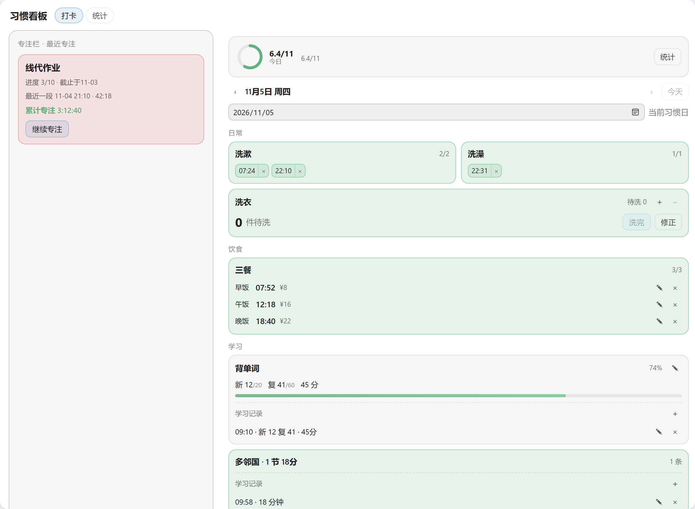
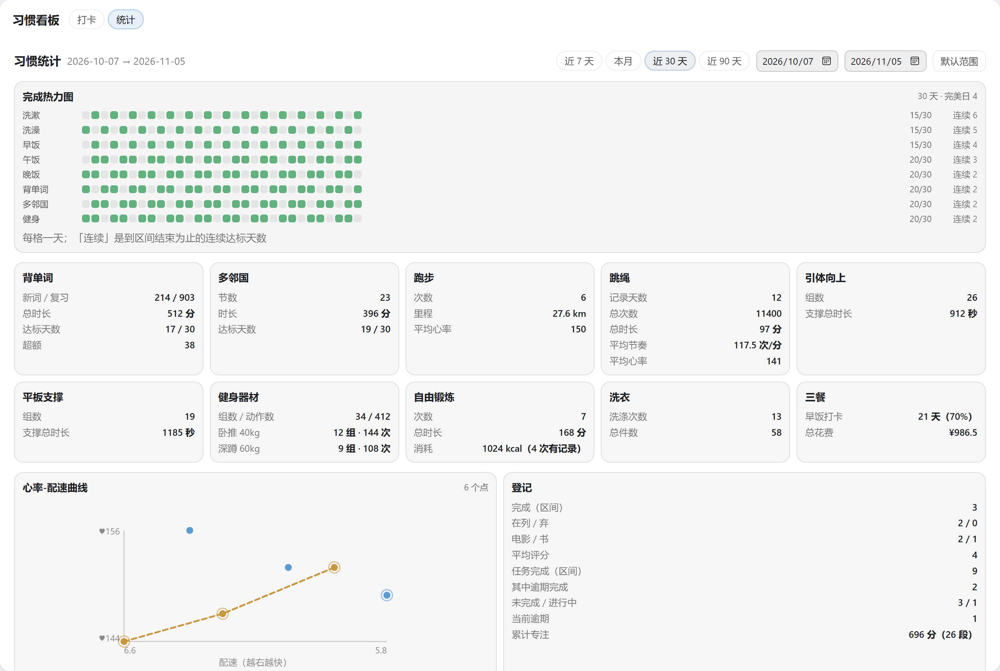
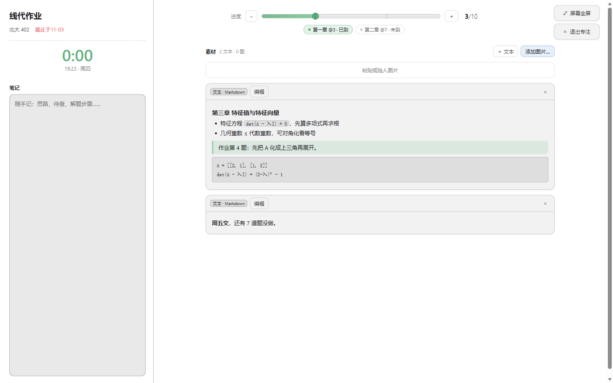

# personal-track

[](./LICENSE)
[](./CHANGELOG.md)
[](./AGENTS.md#commands)
[](https://github.com/deepseek-ai/deepseek-harness)
[](#install)

[中文](./README.md) · **English**

A habit board for [DeepSeek Harness](https://github.com/deepseek-ai/deepseek-harness):
one main panel — the **focus column** on the left, the day's **check-ins** and the
**statistics** in the middle — and, on clicking a task or a film/book, a full-screen
**focus mode** with notes and Markdown/image materials. The interface follows the
shell's language (English / 中文).



| Check-in | Statistics |
|---|---|
|  |  |

## What it tracks

| Group | Habits |
|---|---|
| Daily | Washing up ×2, shower, laundry (a stock gauge and a wash session are separate records) |
| Meals | Breakfast / lunch / dinner: one tap stamps the time, editable with a price |
| Study | Vocabulary (weighted against the day's target; a review word counts a fifth of a new one), Duolingo (any number of lessons) |
| Training | Run (pace derived), jump rope (free count, tempo derived), pull-ups, plank, gym equipment, free-form training |
| Records | Films and books (three states + rating), tasks (progress → three states + overdue, draggable bar, checkpoints) |

**The completion bar is fractional, not a row of checkboxes.** Beyond the nine habit
cells, every task due that day takes a cell of its own, so a reading looks like
`5.3/10`; each cell fills with green in proportion to its own fraction and shows the
percentage on hover. Training is a **presence cell** — a run, a rope session, a set of
pull-ups, a plank, a machine or a free session fills it — so a rest day reads `8/9`
rather than full.

**Focus mode** is an opaque full-screen surface: name, deadline, total focus time and
notes on the left, a thin toolbar on the right (draggable progress bar, ± buttons,
clickable checkpoints), and the **materials** stream below it (Markdown text blocks plus
images, added by paste or drop). Entering starts a **focus session**, leaving ends it;
durations are derived from the two instants, and a session left open by a crash does not
count.

**The focus column is derived**: it shows the closed session with the latest start
across every entry — nothing stored, nothing in browser storage — so a reload, another
tab or a deleted entry all answer the same way. It has no ×: to change the card, focus on
something else.

**Copy as plain text** flattens the day you are looking at into a few lines that paste
into a chat: the completion figure, one line per group, then the task list (everything
unfinished plus anything finished with a deadline today or later, each with its
`M-D` deadline, overdue marked, finished items ending in `✓`).

## Install

> **Recommended: fork it, let DSH edit the fork, then install it with `link:`.**
>
> Everyone's habit list differs, and this plugin's configurable surface is *deliberately*
> small: four fields go through `Config`, everything else is code. Turning habits,
> groups and statistic cards into enum switches in the UI would only make the interface
> noisier, and it would still never be exhaustive — eight counters, five session kinds
> and which cells merge into one habit are all judgements that keep changing. Editing
> your own fork through DSH is cheaper than adding switches: point the agent at
> [AGENTS.md](./AGENTS.md) and [CONTEXT.md](./CONTEXT.md) and it will follow this
> repo's own rules; run `pnpm test` afterwards to see what it broke.
>
> So do not install it as-is looking for a "configure habits" switch (there is none).
> Fork it, change it to your own routine, and install it with option A.

```powershell
# A — local (recommended): link skips packing and pnpm's build approval
dsh plugin --profile web add link:D:/Projects/dsh-personal-track
dsh --profile web --dump-config        # should show the "# == @ds-hu/personal-track" layer
# then restart: dsh --profile web

# B — from GitHub: the repo carries source only; lib/ is built by `prepare` at install time
dsh plugin --profile web add github:ds-hu/dsh-personal-track
# pnpm 11 blocks a dependency's build scripts, so the first attempt fails with
# ERR_PNPM_GIT_DEP_PREPARE_NOT_ALLOWED and prints the exact key (tarball URL + commit sha).
# Copy it verbatim into the profile's pnpm-workspace.yaml:
#   allowBuilds:
#     @ds-hu/personal-track@https://codeload.github.com/ds-hu/dsh-personal-track/tar.gz/<sha>: true
# then run the same add again. The key carries the sha, so every new commit needs a new approval.

# C — try it without installing
dsh --profile web --patch D:/Projects/dsh-personal-track/dev.patch.yml
```

Only four fields are configuration (in `cordis.yml`, no code change needed):

| Field | Default | Effect |
|---|---|---|
| `dayStartHour` | `4` | Where the habit day starts; 00:00–04:00 belongs to the previous evening |
| `timezone` | the machine's | Fixed time-zone override |
| `defaultVocabTarget` | `{ new: 20, review: 60 }` | Vocabulary target when nothing historical can be inherited |
| `defaultRunMinutes` | `30` | Default duration of a new run |

Everything else lives in the source: how a cell counts as met is
`src/host/derive.ts`, the groups and cards are `src/client/board/BoardBody.tsx`,
and every word the interface says is `src/client/copy/table.ts`.
See the **习惯清单** entry in [CONTEXT.md](./CONTEXT.md) and [AGENTS.md](./AGENTS.md).

## Data

`~/.dsh/storages/habit/`, human-readable JSON, one record per file:
`days/<date>.json` (one habit day), `counters/laundry.json` (the stock),
`media/<id>.json`, `tasks/<id>.json` (registry entries), `assets/<id>.json`
(material image bytes). **An empty day produces no document**, and only facts are
stored — cell counts, ratios, streaks, overdue marks and focus totals are all derived
on read.

**Backup**: "Export" in the statistics view writes `personal-track-<date>.json`
(format `personal-track/backup`, version 3) holding facts only, so the file cannot
contradict the data it came from. v1 and v2 files still import; the other direction does
not (an older build rejects a version it does not know rather than dropping fields).
Picking a file only parses it and shows the counts — nothing is written until you choose
**merge** (same keys overwrite) or **replace** (also deletes local records the file omits).
The whole file is validated against one schema first, and one bad record rejects it all.

## Development

```powershell
pnpm install     # installs dependencies; `prepare` also builds
pnpm build       # lib/index.js (host) + lib/client.js (browser closure factory)
pnpm test        # runs tests/*.test.ts one file per process
pnpm typecheck   # three separate programs: host / browser / tests
pnpm verify      # build + client facade + host end-to-end against real storage
```

**Host-half changes need a `dsh --profile web` restart**; client-bundle changes hot
reload. Rules, traps and the verification standard live in [AGENTS.md](./AGENTS.md);
the domain language is [CONTEXT.md](./CONTEXT.md); the reasoning is in
[docs/adr/](./docs/adr/); per-version changes are in [CHANGELOG.md](./CHANGELOG.md).

## Layout

```
src/shared/   pure rules both halves share: the route table, habit-day arithmetic,
              focus sessions, rope merging
src/host/     zod domain + derivation + store access + routes + stats + backup
src/client/   api (the command face) · copy/ (every word the panel says) · board/
              (board, statistics, focus, materials) · styles.ts · index.tsx
scripts/      build.mjs · run-tests.mjs · verify-client.mjs · verify-host.mjs
tests/        the rules (in process, no ports, no disk); wiring and persistence live
              in scripts/verify-*.mjs
docs/adr/     0001 out-of-tree transport · 0002 derived state is not stored ·
              0003 images stored in the domain as base64 · 0005 the shared habit day
```

The icon is `icon.svg` (a completion ring); the Plugins panel's title and one-liner come
from `locale/{zh,en}.json`.
