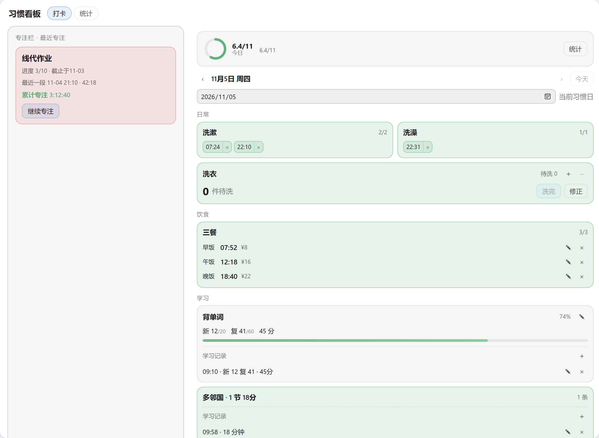
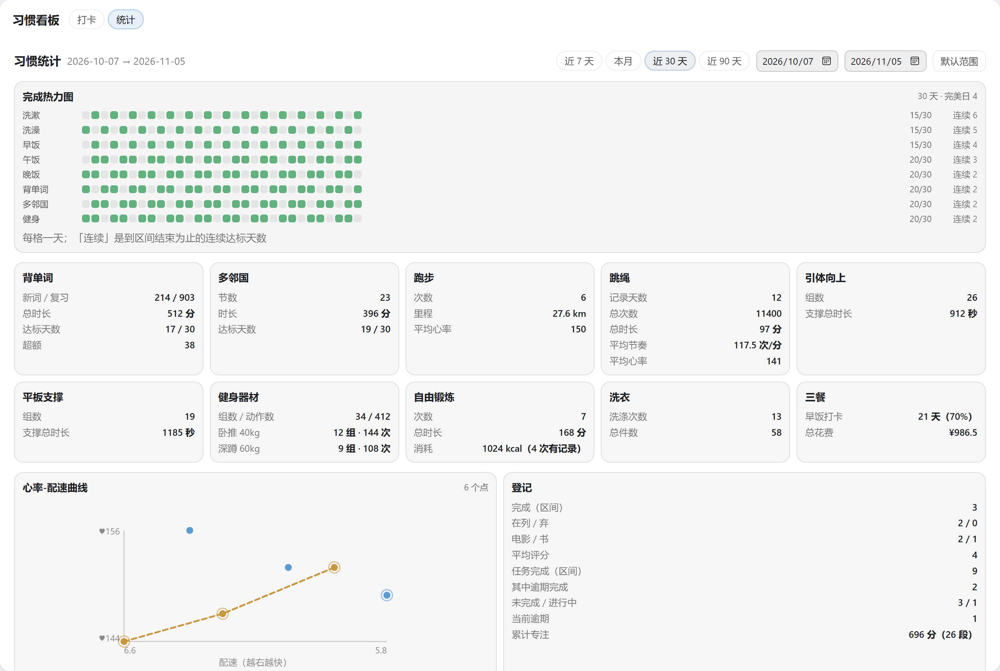
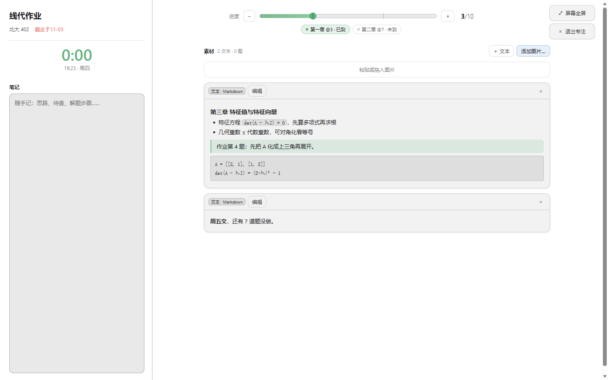

# personal-track

[](./LICENSE)
[](./CHANGELOG.md)
[](./AGENTS.md#命令)
[](https://github.com/deepseek-ai/deepseek-harness)
[](#安装)

**中文** · [English](./README.en.md)

给 [DeepSeek Harness](https://github.com/deepseek-ai/deepseek-harness) 写的一个习惯看板：一个主面板，
左手边**专注栏**，中间**当日打卡**与**统计**；点开任务或影视书籍就是全屏的**专注模式**（笔记 + 素材）。界面跟随外壳语言（中文 / English），切换即时生效。



| 打卡 | 统计 |
|---|---|
|  |  |

## 它管什么

| 分组 | 内容 |
|---|---|
| 日常 | 洗漱 ×2、洗澡、洗衣（存量 ±1 与「洗完」会话分开记） |
| 饮食 | 早饭 / 午饭 / 晚饭：点一下盖时间戳，可改时间与价格 |
| 学习 | 背单词（按当日目标、加权进度，复习词按 1/5 计）、多邻国（任意节数） |
| 健身 | 跑步（配速派生）、跳绳（一天多组、节奏派生）、引体向上、平板支撑、健身器材、自由锻炼 |
| 记录 | 影视书籍（三态 + 评分）、任务（进度 → 三态 + 逾期，可拖进度条，带检查点） |

**完成条是分数的，不是复选框**：九个习惯格之外，当日到期的任务各占一格，所以读数是 `5.3/10` 这样的小数；
每格按自己的分数渐变填绿，悬停给出百分比。「健身」是**存在格**——任一训练有记录就填满，所以休息日读 `8/9`。

**专注模式**是整屏的不透明工作面：左侧名称/截止/累计专注/笔记，右上一条细工具条（进度条可拖、可 ±、
检查点可点），右下是**素材**流（Markdown 文本块 + 图片，粘贴或拖入即加）。进即开始一段**专注会话**，出即结束；
时长只由起止时刻派生，崩掉的未闭合会话不计。

**专注栏**是一张**待办**清单：上面直接写一条、按回车就加上，勾选框只管它自己的完成（与任何任务的进度无关）；
下面一栏是**派生**的"专注过"——有专注记录的任务与影视书籍，按最近一次专注排在最前，点标题进专注模式。
待办本身也不存"最近"这类记忆：刷新、换标签页、删掉条目之后，两栏都与历史一致。
手机（≤720px）上这一栏折成一行「待办 · N 条未完成」，点开才展开，看板因此不被推走。

**复制纯文本报告**把正在看的一天折成几行贴得进聊天：完成度、每组习惯一行，末尾是任务列表
（全部未完成 + 当日及以后截止的已完成，每条都写截止日 `M-D`，逾期注明，已完成行末 `✓`）。

## 安装

> **推荐用法：fork 一份，让 DSH 自己改，再 `link:` 装上。**
>
> 每个人的习惯表都不一样，而这个插件的「可配置面」是**故意**小的：四个字段走 `Config`，其余全在代码里。
> 把习惯、分组、统计卡做成界面上的枚举开关，只会让界面越来越杂，而且永远列不全——八个计数器、
> 五种会话、谁和谁合成一格，都是会变的判断。在 DSH 里改自己 fork 的那份比加开关便宜：
> 让 agent 先读 [AGENTS.md](./AGENTS.md) 与 [CONTEXT.md](./CONTEXT.md)，它就照本仓库自己的规矩改，
> 改完跑一遍 `pnpm test` 就知道有没有把别处弄坏。所以**不要**原样装上再找「配置习惯」的开关（没有）——
> fork 之后改成自己的作息，用下面的方式 A 装上。

```powershell
# A —— 本机（推荐）：link 不打包、不触发 pnpm 的构建审批；装完重启 dsh --profile web
dsh plugin --profile web add link:D:/Projects/dsh-personal-track
dsh --profile web --dump-config        # 应出现 "# == @ds-hu/personal-track" 层

# B —— 从 GitHub 装：仓库只有源码，lib/ 由 prepare 在安装时现场构建
dsh plugin --profile web add github:ds-hu/dsh-personal-track
# pnpm 11 默认拦下依赖的构建脚本，首次会以 ERR_PNPM_GIT_DEP_PREPARE_NOT_ALLOWED 失败，
# 并打印精确键（含 tarball 与 commit sha）。原样抄进 profile 的 pnpm-workspace.yaml：
#   allowBuilds:
#     @ds-hu/personal-track@https://codeload.github.com/ds-hu/dsh-personal-track/tar.gz/<sha>: true
# 再跑一次同样的 add 即可。键里带 sha，仓库每推一个新提交就要重新批准一次。

# C —— 临时试用，不安装
dsh --profile web --patch D:/Projects/dsh-personal-track/dev.patch.yml
```

只有四个字段走配置（写在 `cordis.yml`，不改代码就能调）：
| 字段 | 默认 | 作用 |
|---|---|---|
| `dayStartHour` | `4` | 习惯日起点；00:00–04:00 归前一晚 |
| `timezone` | 本机时区 | 固定时区覆盖 |
| `defaultVocabTarget` | `{ new: 20, review: 60 }` | 无历史目标可继承时的背单词目标 |
| `defaultRunMinutes` | `30` | 新跑步记录的默认时长 |

其余都在源码里：改哪一种格怎么算达成改 `src/host/derive.ts`，改卡片与分组改
`src/client/board/BoardBody.tsx`，改文案改 `src/client/copy/table.ts`。
逐条清单见 [CONTEXT.md](./CONTEXT.md) 的**习惯清单**与 [AGENTS.md](./AGENTS.md)。

## 数据

`~/.dsh/storages/habit/`，人类可读的 JSON，per-record 布局：
`days/<日期>.json`（一个习惯日）、`counters/laundry.json`（待洗存量）、
`media/<id>.json`、`tasks/<id>.json`（登记条目）、`assets/<id>.json`（素材图片字节）。
**空白天不产生文档**；只存事实，格数、比率、连续、逾期、专注时长都是读的时候派生的。

**备份**：统计视图的「导出」得到 `personal-track-<日期>.json`（格式 `personal-track/backup`，版本 3），
只含事实——导入后重算一切派生值，所以文件里不可能出现与数据矛盾的字段。v1 / v2 仍可导入；反向不行
（旧的构建会整份拒绝它不认识的版本）。「选择备份…」只解析并显示条数，此时还没写入；随后选**合并**
（同键覆盖）或**覆盖**（额外删掉文件里没有的本地记录），整份先按同一套 schema 校验，任何一条不合法即整份拒绝。

## 开发

```powershell
pnpm install     # 装依赖；prepare 顺带 build
pnpm build       # lib/index.js（宿主）+ lib/client.js（浏览器闭包工厂）
pnpm test        # 逐文件跑 tests/*.test.ts
pnpm typecheck   # 宿主 / 浏览器 / 测试三个独立程序
pnpm verify      # 构建 + 客户端 facade + 宿主真实栈端到端
```

改完**动过宿主半身要重启 `dsh --profile web`**，只动客户端 bundle 是热重载。规则、坑与验证口径在
[AGENTS.md](./AGENTS.md)，领域术语在 [CONTEXT.md](./CONTEXT.md)，设计背景在 [docs/adr/](./docs/adr/)，版本变化在 [CHANGELOG.md](./CHANGELOG.md)。

## 结构

```
src/shared/   两半身共用的纯规则：路由声明、习惯日算术、专注会话、跳绳合并
src/host/     zod 域 + 派生 + 存储访问 + 路由 + 统计聚合 + 备份读写
src/client/   api（命令面）· copy/（全部界面文字）· board/（看板、统计、专注、素材）
              styles.ts（注入式样式表）· index.tsx（唯一主面板 + 侧栏入口）
scripts/      build.mjs · run-tests.mjs · verify-client.mjs · verify-host.mjs
tests/        规则层（进程内、无端口、无磁盘）；接线与持久化在 scripts/verify-*.mjs
docs/adr/     0001 树外传输 · 0002 状态派生不落库 · 0003 图片存域内 base64 · 0005 共享习惯日
```

图标 `icon.svg`（完成度环），Plugins 面板的标题与一句话说明来自 `locale/{zh,en}.json`。
